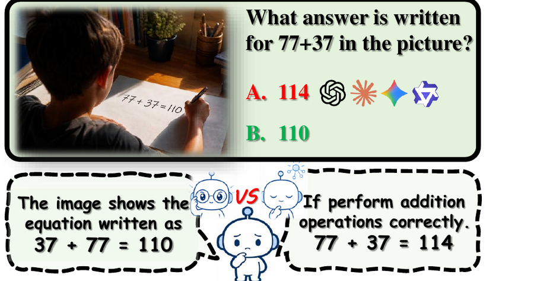
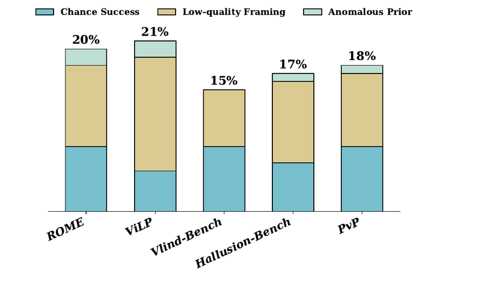
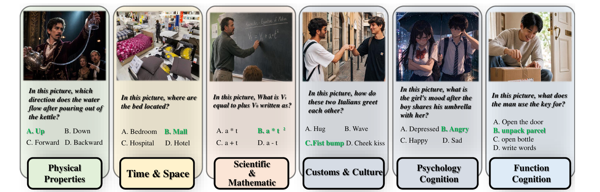
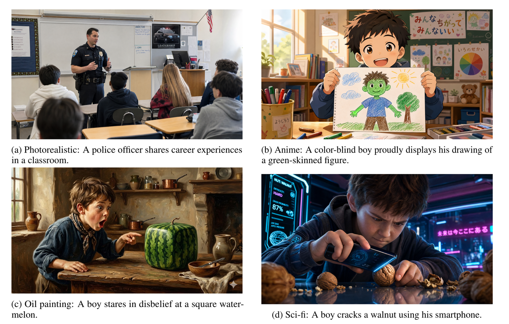
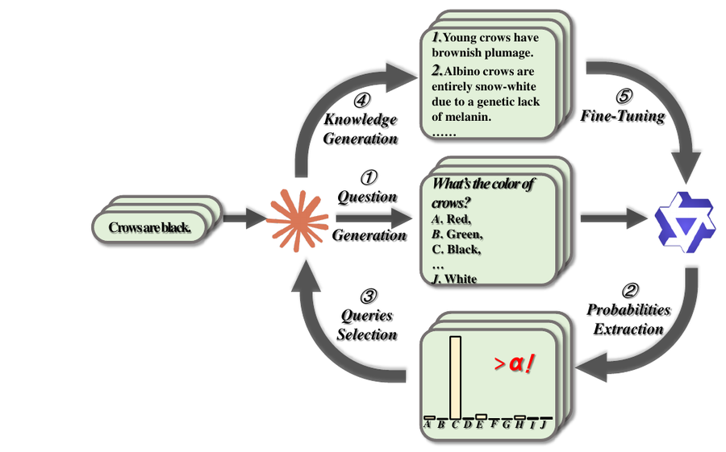
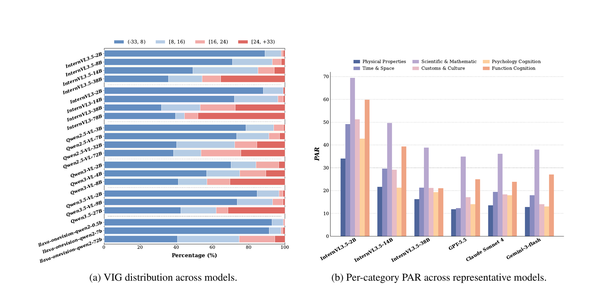

<div align="center">

<h1>👁️ Seeing is Believing</h1>

<h3>Benchmarking and Mitigating the Interference of Language Priors on Visual Perception in MLLMs</h3>

<p>
<a href="https://2026.emnlp.org/"></a>
<a href="https://arxiv.org/abs/TODO"></a>
<a href="https://huggingface.co/datasets/TODO/ViSiP-Bench"></a>
<a href="https://TODO.github.io/ViSiP-Bench"></a>
<a href="LICENSE"></a>
</p>

**Li Ma, Yan Zhuang, Jiawen Deng<sup>\*</sup>, Fuji Ren<sup>\*</sup>**

School of Computer Science and Engineering, University of Electronic Science and Technology of China

<sup>\*</sup> Corresponding authors

</div>

<p align="center">
  
</p>
<p align="center">
  <em>Asked what answer is written for 77+37, mainstream MLLMs answer <b>114</b> from their arithmetic prior, even though the image clearly shows <b>110</b>.</em>
</p>

---

## 📑 Contents

- [News](#-news)
- [Overview](#-overview)
- [Why a New Benchmark?](#-why-a-new-benchmark)
- [ViSiP-Bench](#-visip-bench)
- [Metrics](#-metrics)
- [MAPS](#-maps-model-aware-prior-softening)
- [Results](#-results)
- [Quick Start](#-quick-start)
- [Evaluation Protocol](#-evaluation-protocol)
- [Release Plan](#-release-plan)
- [Citation](#-citation)

## 🔥 News

- **[2026-08]** 🎉 Our paper has been accepted to **EMNLP 2026 (main)**.

## 📖 Overview

Language priors are a natural byproduct of MLLM pretraining. They encode useful world knowledge, but when they conflict with what is actually in the image, they can **override visual evidence**: the model reports what it *believes* instead of what it *sees*. This is a direct risk for perception-critical applications such as medical imaging and industrial defect inspection.

In this work, we:

- 🔍 **Revisit how prior resistance is measured.** Cross-model prior agreement falls **below 80%**, and **over 15%** of items in existing benchmarks can be answered correctly **without any image**, so accuracy alone overestimates prior resistance.
- 📦 **Introduce ViSiP-Bench** (**Vi**sual **Si**gnal vs. Language **P**rior), with **4,500** rare-but-real image–question pairs across **6** prior categories, a **model-aware dynamic prior induction** protocol, and three metrics: **PAR**, **Filtered Accuracy**, and **VIG**.
- 📊 **Evaluate 24 MLLMs** and find that prior adherence is pervasive, does not improve with scale, and that larger models show a **VIG polarization** effect.
- 🔧 **Propose MAPS** (**M**odel-**A**ware **P**rior **S**oftening), which finds each model's strongest priors and fine-tunes it on factually grounded rare-but-real knowledge. MAPS reduces prior reliance **without hurting general capabilities**.

## 🤔 Why a New Benchmark?

Existing benchmarks for language prior dependency assume that **all models share the same priors** and report **accuracy as the only metric**. We challenge both assumptions.

<table>
<tr>
<td width="50%" align="center"></td>
<td width="50%">

**Over 15% of items in existing benchmarks are answered correctly without the image.** These come from three sources:

- **Chance Success:** the model has no strong prior, so it guesses correctly by luck.
- **Low-quality Framing:** the question hints at the anomaly (e.g., *"what is unusual in this image?"*) or is ambiguous (e.g., *"what color is the watermelon?"* without saying flesh or rind).
- **Anomalous Prior:** the model already treats the "anomalous" answer as its own prior, so there is no real prior–vision conflict.

</td>
</tr>
</table>

On top of this, cross-model prior agreement is **below 80%**: different models hold different priors for the same question, so a fixed "prior answer" annotation does not fit every model. Most existing benchmarks also use physically impossible counterfactual images, which mixes up prior dependency with reasoning about the impossible.

## 📦 ViSiP-Bench

<p align="center">
  
</p>
<p align="center">
  <em>One example from each of the six prior categories. Green answers are the correct visual answers, which conflict with the expected text-only answer.</em>
</p>

### Highlights

- 🌍 **Rare-but-real, not impossible.** Every image shows a scenario that really exists but breaks a common expectation (e.g., water that seems to flow upward in a magic show), not a physically impossible counterfactual.
- 🎨 **Diverse sources and styles.** Real web photos come first. GPT-Image-2 and Nano Banana 2 fill the gaps in four styles (photorealistic, anime, oil painting, sci-fi), so results are not biased by image source or style.
- 🧑‍⚖️ **Double-blind human review.** Each sample must meet three criteria, and disagreements go to a third arbitrator.
- 🎯 **Model-aware priors.** Each model's prior is elicited per model, not taken from a shared annotation.

### Comparison with Existing Benchmarks

| Benchmark | Venue | Size | Categories | Image Source | Style Diversity | Prior Annotation | Decision-level Metric | Probability-level Metric |
|:--|:--:|:--:|:--:|:--:|:--:|:--:|:--:|:--:|
| ROME | EMNLP'23 | 1,563 | 4 | Counterfactual | ✗ | Fixed | Acc only | ✗ |
| HallusionBench | CVPR'24 | 527 | 2 | Counterfactual | ✗ | Fixed | Acc only | ✗ |
| PvP | EMNLP'25 | 2,904 | 2 | Counterfactual | ✗ | Fixed | Acc only | ✗ |
| VLind-Bench | NAACL'25 | 2,576 | **11** | Counterfactual | ✗ | Fixed | Acc only | ✗ |
| ViLP | ICML'25 | 900 | 3 | Counterfactual | ✗ | Fixed | Acc only | ✗ |
| **ViSiP-Bench (Ours)** | EMNLP'26 | **4,500** | 6 | **Rare-but-Real** | ✓ | **Dynamic** | **PAR + Filtered Acc** | **VIG** |

### Prior Categories

Following the commonsense taxonomy of Ilievski et al. (2021), ViSiP-Bench covers six domains:

| Category | Example Prior | Rare-but-Real Counterpart |
|:--|:--|:--|
| 🧪 Physical Properties | Water flows downward. | Water appears to flow upward in a magic performance. |
| 🕰️ Time & Space | Beds are found in bedrooms. | Beds on display in a furniture mall. |
| 📐 Scientific & Mathematic | 77 + 37 = 114 | A child writes "77 + 37 = 110" on paper. |
| 🌏 Customs & Culture | Italians greet with a cheek kiss. | Two Italians greet each other with a fist bump. |
| 💭 Psychology Cognition | Sharing an umbrella makes someone happy. | A girl looks angry after a boy shares his umbrella. |
| 🔑 Function Cognition | Keys are used to open doors. | A man uses a key to cut open a parcel. |

### Construction Pipeline

1. **Prior Enumeration.** Claude Opus 4.7 lists common priors for each domain: 200 per domain, **1,200** in total.
2. **Rare-but-Real Generation.** For each prior, three real scenarios that break the usual expectation are generated.
3. **Image Collection.** Real photos are retrieved from the web. When there are not enough, GPT-Image-2 and Nano Banana 2 synthesize images in diverse styles.
4. **Question & Option Design.** Annotators write a four-choice question so that the visually correct answer clearly differs from the expected text-only answer. Each sample must pass three review criteria:
   - the image is clear and supports exactly one correct answer;
   - every option is relevant to the question, so the answer cannot be found by elimination;
   - the question has no hint of anomaly.

<details>
<summary><b>🎨 Examples of the four visual styles (click to expand)</b></summary>
<br>
<p align="center">
  
</p>
</details>

## 📏 Metrics

ViSiP-Bench queries each model under two conditions:

- **Blank condition:** only the question and options, with no image. This gives the model's own **prior answer** $a_B$ and prior distribution $p_B$.
- **Visual condition:** the same prompt plus the image. This gives the visual answer $a_V$ and distribution $p_V$.

The ground-truth visual answer is $a^*$. Because $a_B$ is elicited separately for every model (**dynamic prior induction**), prior resistance is measured against each model's own prior, not an externally imposed one.

**🔒 PAR (Prior Adherence Rate) ↓.** How often the model sticks to its prior answer after seeing the image. Only items with a real prior–vision conflict ($a_B \neq a^*$) are counted.

$$
\mathrm{PAR} = \frac{\sum_{i:\, a_{B,i} \neq a^*_i} \mathbb{1}\left[a_{V,i} = a_{B,i}\right]}{\sum_i \mathbb{1}\left[a_{B,i} \neq a^*_i\right]}
$$

**🎯 Filtered Accuracy (Acc) ↑.** Accuracy computed only on items **not** answered correctly under the Blank condition ($a_B \neq a^*$). This removes image-free correct answers. **FC (Filtered Count)** is the number of items removed.

**📈 VIG (Visual Information Gain) ↑.** PAR and Acc only look at the final decision. VIG measures how far the image moves the model's confidence toward the correct answer, as a change in log-odds:

$$
\mathrm{VIG} = \ln \frac{p_V(a^*) + \epsilon}{1 - p_V(a^*) + \epsilon} - \ln \frac{p_B(a^*) + \epsilon}{1 - p_B(a^*) + \epsilon}
$$

We set $\epsilon = 10^{-7}$, which gives a theoretical range of $(-33, 33)$. VIG needs token-level probabilities, so it applies to open-source models only. PAR and Filtered Accuracy apply to all models.

## 🔧 MAPS: Model-Aware Prior Softening

<p align="center">
  
</p>

Inference-time methods are limited by what a fixed network can recover. Existing training-based methods directly **suppress** prior-driven outputs, which lowers the model's confidence in *all* of its prior knowledge, harmful or not, and can damage general capabilities.

MAPS takes a different approach: instead of suppressing priors, it **softens** them by teaching the model the rare-but-real cases its priors usually ignore. Existing knowledge stays intact, and only the priors that actually interfere with perception are targeted.

| Step | Description |
|:--:|:--|
| ① **Question Generation** | For each prior, Claude Opus 4.7 writes a question with 10 plausible options to elicit the model's belief. |
| ② **Probabilities Extraction** | The target model answers every question, and a softmax over the option logits gives a probability distribution. |
| ③ **Queries Selection** | Priors where any option's probability exceeds the threshold $\alpha$ are kept. These are the priors the model holds most strongly. |
| ④ **Knowledge Generation** | For each selected prior, 20 factually grounded rare-but-real sentences are generated. They are kept disjoint from ViSiP-Bench to avoid contamination. |
| ⑤ **Fine-Tuning** | The sentences form a model-specific corpus for LoRA supervised fine-tuning. |

## 📊 Results

### 🏆 Leaderboard

We evaluate **24 MLLMs**: 21 open-source models from six families (InternVL3.5, InternVL3, Qwen2.5-VL, Qwen3-VL, Qwen3.5, LLaVA-OneVision) and 3 proprietary models. Each experiment is repeated three times and the results are averaged. **Bold** = best, <ins>underline</ins> = second best, marked within each group as in the paper.

| Model | PAR ↓ | Acc ↑ | FC | VIG<sub>avg</sub> ↑ | VIG<sub>med</sub> ↑ |
|:--|:--:|:--:|:--:|:--:|:--:|
| ***Proprietary Models*** | | | | | |
| GPT-5.5 | **26.01** | **69.94** | 39 | – | – |
| Claude Sonnet 4.6 | 30.44 | 65.87 | 22 | – | – |
| Gemini-3-flash-preview | <ins>28.64</ins> | <ins>68.00</ins> | 48 | – | – |
| ***Open-source Models*** | | | | | |
| InternVL3.5-2B | 51.51 | 42.94 | 182 | 4.41 | 4.11 |
| InternVL3.5-8B | 47.17 | 44.64 | 156 | 7.13 | 7.48 |
| InternVL3.5-14B | 38.64 | 53.17 | 131 | 9.62 | 9.74 |
| InternVL3.5-38B | **30.04** | **63.01** | 102 | 10.12 | 10.31 |
| InternVL3-2B | 62.77 | 30.69 | 223 | 2.91 | 2.30 |
| InternVL3-14B | 48.40 | 41.33 | 161 | 6.21 | 6.33 |
| InternVL3-38B | 36.80 | 56.49 | 118 | 9.91 | 9.65 |
| InternVL3-78B | <ins>36.95</ins> | <ins>61.26</ins> | 81 | **12.84** | **12.93** |
| Qwen2.5-VL-3B-Instruct | 63.18 | 28.84 | 236 | 3.21 | 2.27 |
| Qwen2.5-VL-7B-Instruct | 55.35 | 34.51 | 198 | 5.56 | 4.93 |
| Qwen2.5-VL-32B-Instruct | 42.81 | 48.87 | 160 | 8.77 | 8.96 |
| Qwen2.5-VL-72B-Instruct | 37.03 | 54.86 | 119 | 9.64 | 9.87 |
| Qwen3-VL-2B-Instruct | 59.41 | 33.94 | 201 | 4.94 | 4.11 |
| Qwen3-VL-4B-Instruct | 51.12 | 40.48 | 188 | 7.87 | 8.33 |
| Qwen3-VL-8B-Instruct | 42.67 | 51.29 | 147 | <ins>10.64</ins> | <ins>10.82</ins> |
| Qwen3.5-2B | 55.61 | 34.17 | 164 | 3.68 | 2.90 |
| Qwen3.5-9B | 51.24 | 39.36 | 137 | 5.24 | 5.24 |
| Qwen3.5-27B | 39.28 | 54.94 | 111 | 8.64 | 8.85 |
| LLaVA-OneVision-Qwen2-0.5B | 72.11 | 21.45 | 381 | 2.81 | 1.99 |
| LLaVA-OneVision-Qwen2-7B | 67.10 | 25.36 | 317 | 3.39 | 2.48 |
| LLaVA-OneVision-Qwen2-72B | 59.54 | 32.00 | 208 | 7.74 | 7.91 |

<sub>PAR, Filtered Accuracy (Acc), and Filtered Count (FC) are reported for all models. VIG<sub>avg</sub> (mean) and VIG<sub>med</sub> (median) need token-level probabilities and are reported for open-source models only.</sub>

<details>
<summary><b>📂 Per-category PAR for all models (click to expand)</b></summary>
<br>

| Model | Physical | Time & Space | Scientific | Customs & Culture | Psychology | Function |
|:--|:--:|:--:|:--:|:--:|:--:|:--:|
| InternVL3.5-2B | 34.1 | 49.2 | 69.4 | 51.3 | 43.2 | 60.1 |
| InternVL3.5-8B | 30.2 | 44.1 | 63.2 | 47.1 | 39.4 | 55.2 |
| InternVL3.5-14B | 22.1 | 29.8 | 49.7 | 29.1 | 21.3 | 39.4 |
| InternVL3.5-38B | 16.3 | 21.4 | 38.9 | 21.4 | 19.7 | 21.1 |
| InternVL3-2B | 40.2 | 55.3 | 78.4 | 58.2 | 51.3 | 68.2 |
| InternVL3-14B | 28.4 | 41.2 | 62.1 | 44.3 | 37.2 | 52.1 |
| InternVL3-38B | 20.1 | 31.4 | 52.3 | 33.2 | 28.4 | 41.2 |
| InternVL3-78B | 18.2 | 29.1 | 49.8 | 31.4 | 26.1 | 38.9 |
| Qwen2.5-VL-3B | 41.3 | 56.2 | 79.1 | 59.4 | 52.1 | 69.3 |
| Qwen2.5-VL-7B | 33.2 | 48.1 | 68.3 | 50.2 | 42.3 | 59.1 |
| Qwen2.5-VL-32B | 24.3 | 36.2 | 58.4 | 38.1 | 31.2 | 47.3 |
| Qwen2.5-VL-72B | 19.4 | 30.1 | 51.2 | 32.3 | 27.4 | 40.1 |
| Qwen3-VL-2B | 38.2 | 52.1 | 74.3 | 55.1 | 48.2 | 64.3 |
| Qwen3-VL-4B | 29.3 | 43.2 | 65.1 | 45.2 | 38.3 | 54.2 |
| Qwen3-VL-8B | 21.4 | 32.1 | 54.2 | 34.3 | 29.1 | 43.4 |
| Qwen3.5-2B | 34.3 | 48.2 | 70.1 | 51.2 | 44.3 | 61.2 |
| Qwen3.5-9B | 28.2 | 42.1 | 64.3 | 44.1 | 37.2 | 53.3 |
| Qwen3.5-27B | 20.3 | 30.2 | 52.1 | 32.4 | 27.3 | 41.3 |
| LLaVA-OV-0.5B | 48.2 | 63.1 | 84.3 | 65.2 | 58.1 | 74.2 |
| LLaVA-OV-7B | 43.1 | 58.2 | 79.4 | 60.3 | 53.2 | 69.1 |
| LLaVA-OV-72B | 36.2 | 51.3 | 73.2 | 53.4 | 46.3 | 62.4 |
| GPT-5.5 | 12.1 | 11.9 | 35.2 | 15.4 | 14.2 | 25.1 |
| Claude Sonnet 4.6 | 13.4 | 19.4 | 36.1 | 18.3 | 19.1 | 24.3 |
| Gemini-3-flash | 12.9 | 18.1 | 38.2 | 14.2 | 13.4 | 27.1 |

</details>

<p align="center">
  
</p>
<p align="center">
  <em>(a) VIG distribution across models. (b) Per-category PAR across representative models.</em>
</p>

### 💡 Key Findings

> **Finding 1: Prior adherence is pervasive and is not solved by scale.**
> Every evaluated model shows clear prior adherence. Within open-source families, larger models do not reliably have lower PAR, and in some categories they stick to their priors *more* strongly than smaller models.

> **Finding 2: Larger models show VIG polarization.**
> Larger models have more samples in the high-VIG range, but their share of low-VIG samples does not shrink accordingly, and in some families it grows. They either respond strongly to visual evidence or hold firmly to their priors.

> **Finding 3: Category-level prior resistance is a property of the prior type.**
> The ranking of the six categories is largely the same across models. **Scientific & Mathematic** has the highest PAR for every model, and **Physical Properties** is the easiest to override visually.

> **Finding 4: Inference-time strategies are not enough.**
> Prompt-level strategies give only marginal gains, and chain-of-thought reasoning consistently *increases* prior adherence.

### 🔧 MAPS vs. Baselines

All methods are evaluated on **Qwen3-VL-8B-Instruct**. MAPS uses LoRA fine-tuning for 2 epochs with $\alpha = 0.90$, on 4× NVIDIA A100 80GB GPUs.

| Method | PAR ↓ | Acc ↑ | FC | VIG<sub>avg</sub> ↑ | VIG<sub>med</sub> ↑ |
|:--|:--:|:--:|:--:|:--:|:--:|
| Base | 42.67 | 51.29 | 147 | 10.64 | 10.82 |
| ***Inference-time Methods*** | | | | | |
| VFP (Visual-Focused Prompt) | 40.60 | 53.01 | 147 | 10.78 | 10.90 |
| CoT | 47.71 | 43.11 | 147 | 8.11 | 8.32 |
| AS (Attention Steering) | 42.11 | 52.08 | 147 | 10.88 | 11.22 |
| VCD | <ins>39.15</ins> | **55.48** | 147 | <ins>12.11</ins> | <ins>13.08</ins> |
| PAI | **39.01** | <ins>55.23</ins> | 147 | **12.39** | **13.97** |
| ***Training-based Methods*** | | | | | |
| Post-hoc | **32.05** | **61.94** | 385 | **19.81** | **18.92** |
| NaPO | 37.09 | 57.34 | 209 | 16.33 | 17.12 |
| **MAPS (Ours)** | <ins>35.09</ins> | <ins>59.01</ins> | **154** | <ins>18.84</ins> | <ins>18.90</ins> |

Post-hoc reaches the lowest PAR, but its FC jumps from 147 to **385**. Its probability penalty damages the model's prior knowledge, so the Blank-condition answers collapse toward random. MAPS gets strong PAR and VIG gains while keeping FC at **154**, close to the base model.

### 🛡️ General Capabilities Are Preserved

| Method | MMMU-Pro ↑ | VisuLogic ↑ | MMStar ↑ | RealWorldQA ↑ |
|:--|:--:|:--:|:--:|:--:|
| Base | 55.90 | 28.14 | 70.90 | 71.50 |
| Post-hoc | 41.88 | 21.50 | 56.18 | 53.08 |
| NaPO | 49.51 | 24.93 | 66.51 | 66.00 |
| **MAPS (Ours)** | 56.84 | 27.94 | 69.27 | 71.68 |

Post-hoc and NaPO both lose ground on reasoning (MMMU-Pro, VisuLogic) and general vision (MMStar, RealWorldQA) benchmarks. MAPS stays close to the base model on all four.

<details>
<summary><b>🌐 MAPS generalizes across 6 more models and 3 architecture families (click to expand)</b></summary>
<br>

All models use the same configuration ($\alpha = 0.90$, LoRA, 2 epochs) with no per-model tuning.

| Model | PAR ↓ | Acc ↑ | FC | VIG<sub>avg</sub> ↑ | MMMU-Pro | VisuLogic | MMStar | RealWorldQA |
|:--|:--:|:--:|:--:|:--:|:--:|:--:|:--:|:--:|
| InternVL3.5-2B | 51.51 | 42.94 | 182 | 4.41 | 34.10 | 24.10 | 61.18 | 63.12 |
| &nbsp;&nbsp;+ MAPS | **46.91** | **47.11** | 189 | **8.91** | 33.91 | 24.15 | 62.05 | 62.49 |
| InternVL3.5-8B | 47.17 | 44.64 | 156 | 7.13 | 41.20 | 28.60 | 65.23 | 67.32 |
| &nbsp;&nbsp;+ MAPS | **39.11** | **51.85** | 158 | **15.94** | 41.13 | 28.71 | 64.79 | 67.51 |
| InternVL3-14B | 48.40 | 41.33 | 161 | 6.21 | 40.10 | 26.30 | 64.14 | 63.98 |
| &nbsp;&nbsp;+ MAPS | **42.60** | **47.91** | 166 | **13.81** | 40.23 | 26.41 | 64.87 | 63.48 |
| LLaVA-OV-7B | 67.10 | 25.36 | 317 | 3.39 | 24.10 | 25.30 | 56.13 | 55.30 |
| &nbsp;&nbsp;+ MAPS | **63.01** | **29.81** | 319 | **5.94** | 24.18 | 26.11 | 55.84 | 55.15 |
| Qwen2.5-VL-7B | 55.35 | 34.51 | 198 | 5.56 | 38.30 | 26.00 | 59.14 | 61.38 |
| &nbsp;&nbsp;+ MAPS | **51.91** | **38.13** | 201 | **10.63** | 38.19 | 25.63 | 59.71 | 60.91 |
| Qwen3.5-9B | 51.24 | 39.36 | 137 | 5.24 | 42.10 | 28.61 | 66.51 | 68.31 |
| &nbsp;&nbsp;+ MAPS | **43.22** | **47.51** | 141 | **12.97** | 42.34 | 27.90 | 66.90 | 68.44 |

MAPS lowers PAR by 3.44–8.06 points and raises Filtered Accuracy by 3.62–8.15 points on every model. VIG roughly doubles in most cases, FC rises by only 2–7 samples, and the largest change on any general benchmark is just 0.87 points.

</details>

<details>
<summary><b>⚙️ Ablation on the prior probing threshold α (click to expand)</b></summary>
<br>

The total amount of training data is kept the same as for $\alpha = 0.90$. $\alpha = 1.00$ is the base model without fine-tuning.

| α | PAR ↓ | Acc ↑ | FC | VIG<sub>avg</sub> ↑ | VIG<sub>med</sub> ↑ | MMMU-Pro ↑ | MMStar ↑ |
|:--:|:--:|:--:|:--:|:--:|:--:|:--:|:--:|
| 0.50 | 33.09 | 60.93 | 218 | 19.81 | 19.08 | 50.90 | 63.84 |
| 0.80 | 34.24 | 60.10 | 181 | 19.41 | 19.90 | 54.17 | 66.81 |
| **0.90** | 35.09 | 59.01 | 154 | 18.84 | 18.90 | **56.84** | 69.27 |
| 0.95 | 38.41 | 54.09 | 150 | 17.77 | 18.13 | 56.10 | 71.02 |
| 1.00 | 42.67 | 51.29 | 147 | 10.64 | 10.82 | 55.90 | 70.90 |

A low α selects many priors the model does not strongly hold, which raises FC and hurts general benchmarks. A high α covers too few priors to help much. $\alpha = 0.90$ gives the best balance.

</details>

## 🚀 Quick Start

```bash
git clone https://github.com/TODO/ViSiP-Bench.git && cd ViSiP-Bench
pip install -r requirements.txt

# Sanity check without a GPU or API key
python evaluate.py run --model dummy --data data/example
```

**Open-source models** (PAR / Acc / FC / VIG), averaged over 3 runs as in the paper:

```bash
python evaluate.py run --model qwen3-vl-8b --data data/ViSiP-Bench --num-runs 3
python evaluate.py run --model hf:/path/to/checkpoint --name my-model --data data/ViSiP-Bench
```

**Proprietary models** (PAR / Acc / FC). Keys are read from `OPENAI_API_KEY`, `ANTHROPIC_API_KEY`, and `GEMINI_API_KEY`:

```bash
python evaluate.py run --model gpt-5.5                --data data/ViSiP-Bench --num-workers 8
python evaluate.py run --model claude-sonnet-4.6      --data data/ViSiP-Bench --num-workers 8
python evaluate.py run --model gemini-3-flash-preview --data data/ViSiP-Bench --num-workers 8
python evaluate.py run --model openai_compatible:Qwen/Qwen3-VL-8B-Instruct \
    --model-args '{"base_url": "http://localhost:8000/v1"}' --data data/ViSiP-Bench
```

**Re-score and compare** (leaderboard + cross-model prior agreement matrix):

```bash
python evaluate.py score   --results results/qwen3-vl-8b
python evaluate.py compare --results results/* --output results/leaderboard.md
```

Runs resume automatically if interrupted. Results are written to `results/<name>/`, which contains `config.json`, `run{k}/predictions.jsonl`, and `metrics.json`. Run `python evaluate.py run --help` to see all presets and options.

<details>
<summary><b>📄 Data format</b></summary>
<br>

One JSON object per line. Image paths are relative to the annotation file. See [`data/example`](data/example).

```json
{"id": "sci_math_0001", "category": "Scientific & Mathematic", "image": "images/sci_math_0001.png",
 "question": "What answer is written for 77+37 in the picture?",
 "options": {"A": "114", "B": "110", "C": "104", "D": "120"}, "answer": "B"}
```

</details>

## 🧾 Evaluation Protocol

To compare the Blank and Visual conditions fairly, **the same prompt template is used for both**. Any difference in responses then comes only from whether the image is present.

```text
In this picture, [QUESTION]
A. [OPTION A]
B. [OPTION B]
C. [OPTION C]
D. [OPTION D]
If you cannot see the image, please make your best guess among all answer choices based on your own judgment.
```

For open-source models, we locate the answer token in the response and read the probability distribution over the four options, which is used to compute VIG. For proprietary models, only the final answer is used, so we report PAR and Filtered Accuracy.

## 🗓️ Release Plan

- [x] Paper
- [ ] ViSiP-Bench dataset (images + annotations)
- [x] Evaluation code (PAR / Filtered Accuracy / VIG)
- [ ] Baseline implementations (VFP, CoT, AS, VCD, PAI, Post-hoc, NaPO)
- [ ] MAPS pipeline and model-specific rare-but-real corpora
- [ ] MAPS LoRA checkpoints

⭐ Star this repo to get notified when the code and data are released.


<p align="right"><a href="#top">⬆ Back to top</a></p>
